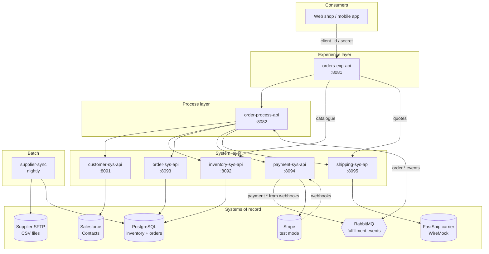

# Order-to-Fulfillment Integration Hub

[](https://github.com/RyanOker/Mulesoft-by-Antonio-Ojeda/actions/workflows/validate.yml)

A MuleSoft portfolio project by **Antonio Ojeda** that shows how an e-commerce
company connects its CRM, database, payment provider, shipping carrier,
message broker and a legacy supplier feed using **API-led connectivity** on
Mule 4.

> **Status: Phase 1 (foundation) is done.** API specs, local infrastructure,
> database and project skeletons are in place. Mule flows are built in the
> next phases. See the [roadmap](docs/roadmap.md).

---

## Architecture



| Layer | Application | Port | Talks to | What it shows |
|-------|-------------|------|----------|----------------|
| Experience | [`orders-exp-api`](apis/orders-exp-api/src/main/resources/api/orders-exp-api.raml) | 8081 | Process + System APIs | Data shaped for screens, Client ID Enforcement, rate limiting, caching |
| Process | [`order-process-api`](apis/order-process-api/src/main/resources/api/order-process-api.raml) | 8082 | All System APIs, RabbitMQ | Orchestration, compensation (saga), Scatter-Gather, async events, idempotency |
| System | [`customer-sys-api`](apis/customer-sys-api/src/main/resources/api/customer-sys-api.raml) | 8091 | Salesforce | Salesforce connector, SOQL, field mapping |
| System | [`inventory-sys-api`](apis/inventory-sys-api/src/main/resources/api/inventory-sys-api.raml) | 8092 | PostgreSQL | DB connector, transactions, stock reservations |
| System | [`order-sys-api`](apis/order-sys-api/src/main/resources/api/order-sys-api.raml) | 8093 | PostgreSQL | Status state machine, event de-duplication |
| System | [`payment-sys-api`](apis/payment-sys-api/src/main/resources/api/payment-sys-api.raml) | 8094 | Stripe, RabbitMQ | REST + API keys, webhook signature check, idempotency keys |
| System | [`shipping-sys-api`](apis/shipping-sys-api/src/main/resources/api/shipping-sys-api.raml) | 8095 | Carrier mock | Timeouts, retries (Until Successful), error mapping |
| Batch | `supplier-sync` | – | SFTP, PostgreSQL | Batch job, CSV with DataWeave, record-level errors |

More detail, including the full order sequence diagram, is in
[docs/architecture.md](docs/architecture.md).

---

## Repository layout

```
.
├── apis/                         One folder per Mule application
│   ├── <name>/
│   │   ├── pom.xml               Inherits versions from the parent POM
│   │   ├── mule-artifact.json
│   │   └── src/main/resources/
│   │       ├── api/<name>.raml   API contract (design-first)
│   │       └── config/           local.yaml (+ local-secrets.example.yaml)
├── shared/raml/                  Shared RAML library (types, traits) - single source of truth
├── infra/                        Everything docker-compose needs
│   ├── postgres/init/            Schema + seed data
│   ├── rabbitmq/                 Vhost, exchanges, queues, dead-letter queue
│   ├── sftp/                     Supplier CSV samples (with deliberate bad rows)
│   └── wiremock/                 FastShip carrier mock, incl. failure scenarios
├── scripts/                      Smoke test, RAML library sync
├── tools/raml-validator/         AMF-based spec validation (used in CI)
├── docs/                         Architecture and roadmap
├── docker-compose.yml
└── pom.xml                       Parent POM: runtime, plugin and connector versions
```

---

## Running it locally

### Prerequisites

- Docker with Docker Compose v2
- [Anypoint Studio](https://www.mulesoft.com/platform/studio) 7.x or [Anypoint Code Builder](https://docs.mulesoft.com/anypoint-code-builder/) (VS Code)
- JDK 17 and Maven 3.9+ (Studio bundles its own)
- Node.js 20+ (only for validating specs)
- Free accounts for the cloud parts: [Salesforce Developer Edition](https://developer.salesforce.com/signup), [Stripe](https://dashboard.stripe.com/register) (test mode), and an [Anypoint Platform trial](https://anypoint.mulesoft.com/login/signup) when you deploy

### 1. Start the backing services

```bash
docker compose up -d
```

```bash
scripts/smoke-test-infra.sh
```

| Service | Address | Credentials |
|---------|---------|-------------|
| PostgreSQL | `localhost:5432`, database `fulfillment` | `inventory_api` / `inventory_api_local`, `orders_api` / `orders_api_local` (admin: `postgres` / `postgres_local`) |
| SFTP | `localhost:2222` | `supplier` / `supplier_local` |
| RabbitMQ | `localhost:5672`, vhost `fulfillment`, UI at <http://localhost:15672> | `mule` / `mule_local` |
| Carrier mock | <http://localhost:8089/v1> | header `X-Api-Key: fastship-local-key` |
| Adminer (optional) | `docker compose --profile tools up -d` then <http://localhost:8088> | as PostgreSQL |

To wipe all data and re-seed:

```bash
docker compose down -v
```

### 2. Try the carrier mock's failure modes

The shipping carrier mock is built to show resilience patterns. Add an
`X-Mock-Scenario` header to any request:

| Header value | Behaviour | Pattern it demonstrates |
|--------------|-----------|-------------------------|
| `slow` | Answers after 8 s | HTTP response timeout |
| `down` | Always `503` | Error mapping, `503` to the caller |
| `flaky` | `503`, `503`, then `201` (`POST /v1/shipments`) | Retry with Until Successful |
| *(postal code `00000`)* | `422 ADDRESS_INVALID` | Business errors that must **not** be retried |

```bash
curl -i -X POST http://localhost:8089/v1/shipments \
  -H 'X-Api-Key: fastship-local-key' -H 'Content-Type: application/json' \
  -d '{"reference":"ORD-100001","destination":{"postal_code":"62704"}}'
```

### 3. Import an API into Anypoint Studio

1. **File → Import → Anypoint Studio → Anypoint Studio project from File System**, pick `apis/<name>`.
2. Right-click `src/main/resources/api/<name>.raml` → **Mule → Generate Flows from Local REST API** (APIkit scaffolding).
3. Run with the VM argument `-Denv=local`.

Each API listens on its own port (table above), so several can run in Studio at once.

### 4. Validate the API specs

```bash
cd tools/raml-validator && npm ci && npm run validate
```

This uses AMF, the same parser as Anypoint Design Center and APIkit, and also
checks that each API's copy of the shared RAML library is up to date. After
editing [`shared/raml/common-library.raml`](shared/raml/common-library.raml), run:

```bash
scripts/sync-raml-common.sh
```

---

## Design decisions

- **Design-first.** Every API has a RAML 1.0 contract with types and examples before any flow exists. Examples are validated against the types in CI.
- **One owner per data store.** Only `inventory-sys-api` touches the `inventory` schema and only `order-sys-api` touches `orders`. Each has its own database user that cannot read the other schema.
- **Idempotency everywhere money or stock is involved.** `Idempotency-Key` header on order creation and payments (passed through to Stripe), one reservation per order, and a `processed_events` table to de-duplicate webhooks and messages.
- **Compensation instead of distributed transactions.** If payment fails, the stock reservation is released and the order is marked `FAILED` (saga pattern), documented step by step in the [Process API spec](apis/order-process-api/src/main/resources/api/order-process-api.raml).
- **One error format.** All APIs return the same `Error` type, which always includes the `correlationId` that is also in the logs.
- **Synchronous where the customer waits, asynchronous where they don't.** Payment happens during checkout; shipping and notifications happen through RabbitMQ, with a dead-letter queue for messages that keep failing.
- **Realistic failure.** The supplier files contain bad rows on purpose, and the carrier mock can be slow, down or flaky.

---

## Roadmap

| Phase | Scope | Status |
|-------|-------|--------|
| 1 | Specs, local infrastructure, DB schema, project skeletons, CI for specs | ✅ Done |
| 2 | System APIs on PostgreSQL + carrier: APIkit flows, DataWeave, global error handling, MUnit | ⏳ Next |
| 3 | Salesforce + Stripe System APIs, webhooks | |
| 4 | Process API orchestration, RabbitMQ events, notifications | |
| 5 | Experience API, `supplier-sync` batch job | |
| 6 | CloudHub 2.0 deployment, API Manager policies, CI/CD with GitHub Actions, demo video | |

Details for each phase: [docs/roadmap.md](docs/roadmap.md).
