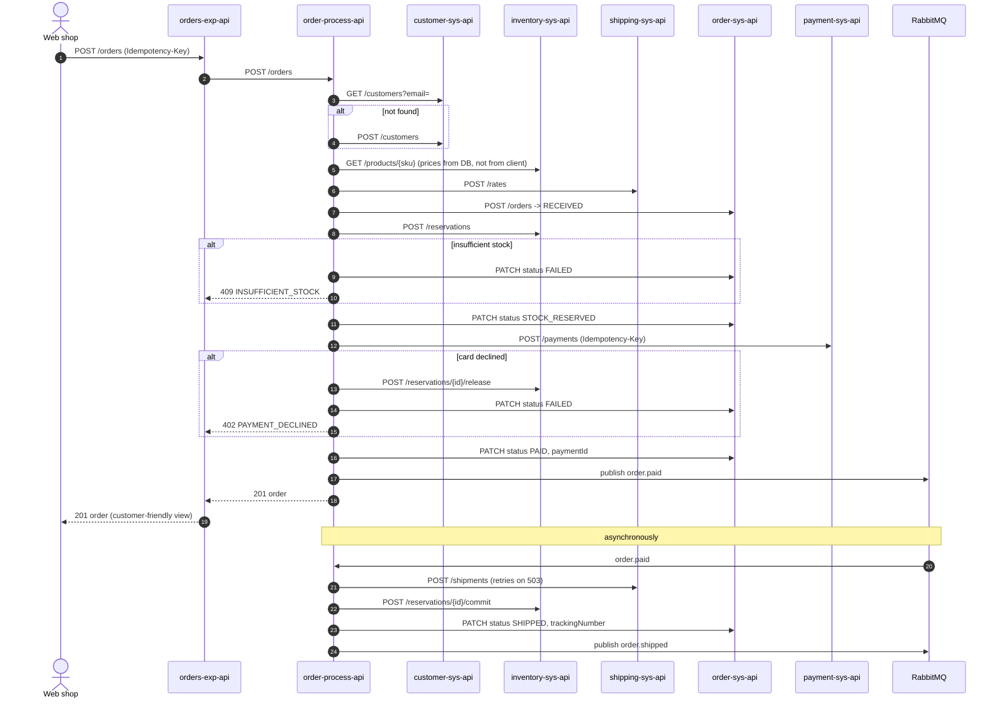
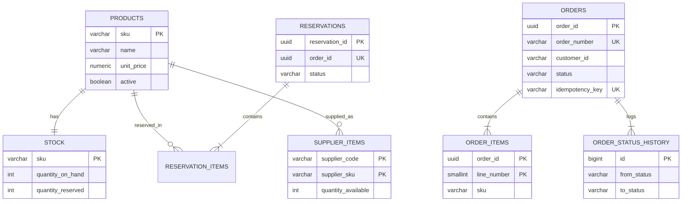

# Architecture

## Business scenario

*Northwind Home Office* sells desks, chairs and accessories online. Before
this project every system was integrated point-to-point. The integration hub
replaces that with reusable APIs:

- Customers live in **Salesforce** (as Contacts).
- Products, stock and orders live in **PostgreSQL**.
- Card payments go through **Stripe**.
- Parcels are shipped with the **FastShip** carrier.
- Two suppliers drop a **CSV stock file on SFTP** every night.
- The warehouse and customer service want **notifications** (Slack, e-mail).

## API-led layers

| Layer | Responsibility | Rule |
|-------|----------------|------|
| **System** | Unlock one system of record. Hide its data model, protocol and credentials. | Contains no business process. Only one System API per data store. |
| **Process** | Implement the business process by combining System APIs. | Owns no data. Talks to systems only through System APIs. |
| **Experience** | Shape data for a specific consumer (web, mobile). | Thin. Security policies applied here in API Manager. |

The System APIs can be reused by any future process (returns, B2B portal,
reporting) without touching Salesforce, Stripe or the database again.

## Place-order sequence

## Events

Exchange `fulfillment.events` (topic) in vhost `fulfillment`:

| Routing key | Published by | Consumed by (queue) |
|-------------|--------------|---------------------|
| `order.created`, `order.paid`, `order.shipped`, `order.cancelled`, `order.failed` | order-process-api | `order-notifications` (Slack / e-mail); `order.paid` also triggers shipping |
| `payment.succeeded`, `payment.failed`, `payment.refunded` | payment-sys-api (from Stripe webhooks) | `payment-events` → order-process-api |
| `shipment.*` | shipping-sys-api (carrier tracking updates, later phase) | `shipment-events` → order-process-api |

All work queues are quorum queues with `x-delivery-limit: 5`. After five
failed deliveries a message is moved through `fulfillment.dlx` to
`fulfillment-dlq` for manual inspection.

## Data model

`inventory.*` and `orders.*` are separate schemas with separate database
users. There are deliberately **no foreign keys between the two schemas**
(`orders.order_items.sku`, `orders.orders.reservation_id`): they belong to
different APIs and could live in different databases.

Full DDL: [`infra/postgres/init/01-schema.sql`](../infra/postgres/init/01-schema.sql).

## Cross-cutting concerns

| Concern | Approach |
|---------|----------|
| Correlation | `X-Correlation-ID` accepted or generated at the edge, passed to every downstream call and message, written in every log line and every error body. |
| Errors | One `Error` type for all APIs (`shared/raml/common-library.raml`). Global error handler per app maps connector errors to HTTP status codes. |
| Configuration | `config/${env}.yaml` per app, secrets in encrypted secure properties. Nothing environment-specific in flows. |
| Security | Experience layer: Client ID Enforcement + Rate Limiting (API Manager). System layer: not public (CloudHub 2.0 private space / internal ingress). Stripe webhooks verified by signature. |
| Resilience | HTTP timeouts on every requester, Until Successful only for idempotent or keyed calls, dead-letter queue for messages. |
| Testing | MUnit per flow with external systems mocked, 80% coverage enforced in CI (from phase 2). |
